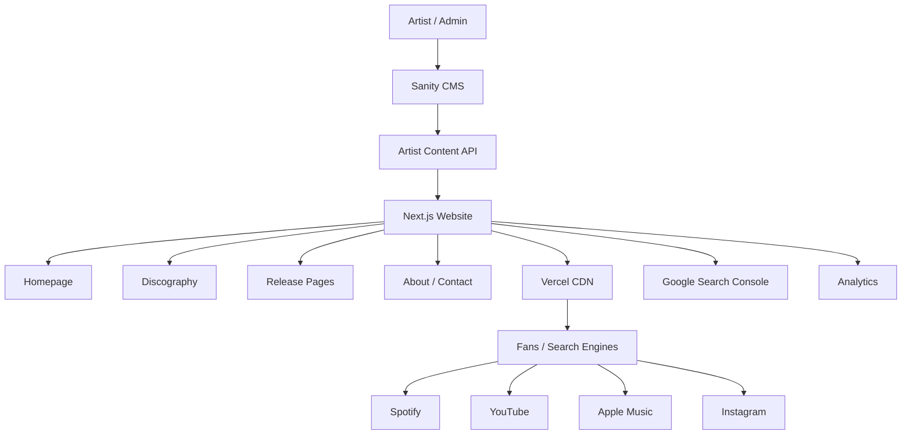
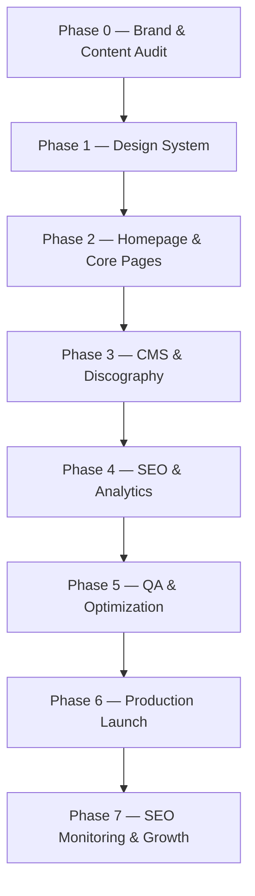

# AKASH BHAI — Official Artist Website
## PLAN.md

**Version:** 1.0  
**Date:** November 6, 2026  
**Status:** Creative direction and MVP scope locked  
**Product:** Official artist website for Akash Bhai  
**Primary objectives:** Artist brand discovery / SEO + memorable cinematic experience  
**Scope:** Lean MVP

---

## 1. Product Vision

Create a cinematic, artist-owned digital home that establishes **Akash Bhai as a recognizable independent recording artist** across search engines, music streaming platforms, and the wider internet.

The website is the canonical source of truth for the artist’s identity, music catalog, biography, and official links.

### Core principle

> The website should be visually memorable to humans and structurally unambiguous to search engines.

This is not a generic musician portfolio, resume, or link-in-bio page. It should feel like an artist’s official universe.

## 2. Problem

Independent artists often rely on third-party platforms such as Spotify, YouTube, Instagram, and Apple Music. This leads to:

- Fragmented artist identity across platforms.
- Search results containing unrelated people with similar names.
- Limited control over artist presentation.
- Releases without dedicated indexable landing pages.
- Dependence on social platform algorithms.
- No central owned destination for press, bookings, collaborators, and fans.

## 3. Proposed Solution

Build a lightweight, cinematic website that:

- Establishes Akash Bhai as a recording artist.
- Centralizes official artist information and profiles.
- Makes every release independently discoverable.
- Converts visitors into listeners and followers.
- Provides a professional destination for media, collaborators, and event organizers.
- Supports long-term organic search authority.

## 4. Product Goals and Metrics

### North-star metric

Growth in artist-branded organic search impressions and clicks for queries associating Akash Bhai with music, songs, releases, and official profiles.

### KPIs

| Objective | KPI |
|---|---|
| Search visibility | Google impressions for branded queries |
| Search traffic | Organic clicks to the official website |
| Identity association | Branded search results pointing to official artist profiles |
| Music discovery | Click-throughs to Spotify / YouTube / Apple Music |
| Audience conversion | Newsletter subscriptions (future/P1) |
| Engagement | Release page views and streaming-link clicks |
| Technical SEO | Canonical pages indexed |
| Performance | Core Web Vitals passing thresholds |

### Initial 90-day target hypotheses

These are targets, not guarantees:

- Website indexed during the initial launch period.
- All canonical release pages eligible for indexing.
- Growth in branded query impressions from baseline.
- Organic CTR above 5% for relevant branded queries where ranking position allows.
- Lighthouse Performance score of 90+ on mobile for primary pages.
- Zero critical SEO or accessibility errors.

SEO outcomes depend on domain history, content quality, competition, backlinks, and search-engine behavior. Rankings and Knowledge Panels cannot be guaranteed.

## 5. Audience

### Primary audiences

| Audience | Intent |
|---|---|
| Existing fans | Listen to music and explore releases |
| New listeners | Discover who Akash Bhai is |
| Search users | Find official artist information |
| Music bloggers / journalists | Research biography and music |
| Event organizers | Find booking and contact details |
| Collaborators | Access artist profiles and official links |

### Personas

- **Curious listener:** Encounters a song or lyric, searches Akash Bhai, and wants more music.
- **Existing fan:** Wants releases, lyrics, videos, and updates.
- **Industry professional:** Wants a credible artist profile, biography, music links, and contact information.

## 6. Creative Direction

### Locked direction

- **Visual:** Cinematic and dark.
- **Primary objective:** SEO and memorable artistic experience equally.
- **Scope:** Lean MVP.

### Design philosophy

- Cinematic, not cluttered.
- Premium, not corporate.
- Emotional, not overly decorative.
- Dark, but not visually flat.
- Expressive, but usable.
- Minimal in content structure, rich in atmosphere.

### Color palette

| Token | Name | Hex |
|---|---|---|
| `obsidian` | Obsidian | `#090909` |
| `charcoal` | Charcoal | `#171717` |
| `bone` | Bone | `#F0EDE7` |
| `oxblood` | Oxblood | `#641E26` |
| `muted-taupe` | Muted Taupe | `#A89B8C` |
| `graphite` | Graphite | `#333333` |

### Typography

- Display: condensed, bold, expressive sans-serif.
- Editorial accent: elegant serif italic.
- Wordmark: `AKASH BHAI`.
- Use type hierarchy and whitespace rather than excessive decoration.

### Motion

- Slow image reveals.
- Subtle opacity transitions.
- Smooth transitions where appropriate.
- Slight hero parallax only if performance and accessibility remain good.
- No excessive scroll hijacking.
- No autoplay audio or video.
- Honor `prefers-reduced-motion`.

### Brand assets required

- Artist wordmark: `AKASH BHAI`.
- Artist hero photograph.
- Artist profile photograph.
- Logo/favicon.
- Release cover artworks.
- Social sharing / Open Graph image.
- Optional animated wordmark.

Use authentic, artist-approved visual assets. Generated art may be used for textures/backgrounds, but must not falsely depict the artist.

## 7. Information Architecture and Routes

```text
/
├── /music
│   ├── /music/jyot
│   └── /music/[slug]
├── /about
├── /contact
└── /privacy
```

| Route | Purpose | Indexing |
|---|---|---|
| `/` | Official homepage | Index |
| `/music` | Complete discography | Index |
| `/music/jyot` | JYOT release page | Index |
| `/music/[slug]` | Other release pages | Index |
| `/about` | Artist biography | Index |
| `/contact` | Booking / professional contact | Index |
| `/privacy` | Privacy policy | Index |

The MVP excludes separate press, blog, tour, merchandise, and fan-community systems.

## 8. Page Requirements

### 8.1 Homepage — P0

**Objective:** Immediately communicate who Akash Bhai is and direct visitors toward the music.

#### Hero

- Full-screen or majority-viewport cinematic visual.
- Artist wordmark.
- Designation: `INDEPENDENT RECORDING ARTIST`.
- Main heading: `AKASH BHAI`.
- Supporting line: `Music. Identity. Emotion.`
- Primary CTA: `LISTEN TO JYOT`.
- Secondary CTA: `EXPLORE THE MUSIC`.
- Minimal navigation.

Hero should feel like a film opening sequence.

#### Sections

1. Hero.
2. Featured release (JYOT initially).
3. Discography preview (recent releases).
4. Artist introduction / short biography.
5. Official streaming and social links.
6. Footer.

### 8.2 Music / Discography — P0

- Responsive artwork grid.
- Newest releases first.
- Release card: artwork, title, type, year.
- Card opens dedicated release page.
- All release data is CMS-managed; no hardcoded catalog in UI.
- Categories: singles, EPs, albums, collaborations.

### 8.3 Release detail page — P0

Each release page includes:

- Cover artwork.
- Release title and artist name.
- Release date.
- Artist-approved description/context.
- Streaming links.
- Official video, if available.
- Lyrics, if approved and supplied.
- Related releases.

### 8.4 JYOT release page — P0

Initial featured release.

- Title: `JYOT`.
- Artist: `Akash Bhai`.
- Release date: October 23, 2026.
- Cover art.
- Official streaming links.
- Official music video, if available.
- Artist-approved lyrics.
- Description / context.
- Share links.

Suggested SEO title:

`JYOT — Akash Bhai | Official Song`

Suggested meta description:

`Listen to JYOT by Akash Bhai, released October 23, 2026. Explore the official song, lyrics, and streaming links.`

All metadata and links must be verified against actual artist-approved data before launch.

### 8.5 About — P0

- Artist portrait.
- Artist biography.
- Musical identity and influences.
- Background.
- Career milestones (only verified).
- Selected releases.
- Official profiles.
- Professional contact.

Biography must be authentic and artist-approved. Do not fabricate accomplishments, awards, press coverage, or career history.

### 8.6 Contact — P0

- Booking / performance inquiry.
- Collaboration inquiry.
- Press inquiry.
- Approved business email.
- Official social profiles.

A form is optional for MVP. A protected professional email link may be used initially.

## 9. Global Components

### Navigation

Desktop:
- Wordmark.
- Music.
- About.
- Contact.
- Listen CTA.

Mobile:
- Wordmark.
- Menu icon.
- Compact or full-screen overlay navigation.

Navigation must remain minimal and subordinate to content.

### Footer

- `AKASH BHAI`.
- Artist designation.
- Streaming platform links.
- Social links.
- Navigation.
- Copyright.
- Privacy policy.

### CTA components

- Primary: `LISTEN NOW`.
- Secondary: `EXPLORE MUSIC`.
- Tertiary: `DISCOVER AKASH BHAI`.

All CTAs must be functional links, not decorative controls.

## 10. SEO and Artist Identity Architecture

SEO is a first-class requirement.

### Canonical identity

The website should consistently establish:

- Akash Bhai as a recording artist.
- Akash Bhai as the creator of the published catalog.
- Akash Bhai as the owner of the official website.
- Akash Bhai linked to official streaming and social profiles.

Maintain consistent display name, artist image, biography, website URL, and profile links across platforms.

### Structured data

Use Schema.org JSON-LD.

- Homepage: choose the most accurate entity type (`Person` for the individual artist; `MusicGroup` only if it accurately represents the act). Avoid competing entities.
- Release pages: `MusicRecording` for recordings and `MusicAlbum` where an actual album entity exists.
- Include factual properties supported by visible page content, such as `name`, `byArtist`, `datePublished`, `url`, `image`, `inAlbum`, `duration` (when known), and `recordingOf` (when applicable).

### Technical SEO checklist

- Unique title tag per route.
- Unique meta description per route.
- Canonical URL on every indexable page.
- `sitemap.xml`.
- `robots.txt`.
- Open Graph metadata.
- Twitter/X card metadata.
- Semantic HTML heading hierarchy.
- Descriptive image alt text.
- Internal links between artist and release pages.
- Breadcrumbs on release detail pages.
- Valid JSON-LD matching visible content.
- Google Search Console setup.
- Bing Webmaster Tools setup.
- HTTPS and permanent redirects.
- No accidental `noindex`.
- Proper 404 page for invalid release slugs.
- Consider image sitemap if useful.

### Keyword / intent mapping

| Page | Primary query intent |
|---|---|
| Homepage | Akash Bhai musician |
| About | Akash Bhai artist biography |
| Music | Akash Bhai songs |
| JYOT | Akash Bhai JYOT |
| Release pages | Akash Bhai + release title |
| Contact | Akash Bhai booking / contact |

Avoid keyword stuffing. Create useful pages that naturally reinforce artist identity.

### Entity authority

Link to official artist profiles. Pursue legitimate external links from:

- Music blogs.
- Interviews.
- Event listings.
- Festival pages.
- Collaborators’ websites.
- Music publications.
- Artist directories.

Do not purchase spammy backlinks or create fake profiles.

### Search Console

- Verify domain property.
- Submit XML sitemap.
- Inspect homepage and release URLs.
- Monitor indexing coverage.
- Track branded queries, impressions, clicks, CTR, average position, and search appearance.

## 11. Recommended Technical Stack

- Next.js (App Router).
- TypeScript.
- Tailwind CSS.
- Sanity CMS.
- Vercel hosting.
- Motion / Framer Motion for restrained animations.
- `next/image` for image optimization.
- Zod for validation where useful.
- Google Search Console.
- GA4 or privacy-friendly analytics.

No custom backend is required for the MVP.

### Rendering

- Homepage: server-rendered or statically generated.
- Discography: statically generated.
- Release pages: statically generated with dynamic metadata.
- About: statically generated.
- Contact: statically generated.
- CMS changes: revalidation or redeployment.

Search engines should receive meaningful HTML without needing client-side JavaScript to understand artist or release content.

### Architecture



## 12. CMS Data Models

### Artist

| Field | Type |
|---|---|
| `name` | String |
| `slug` | String |
| `biography` | Rich text |
| `shortBiography` | Text |
| `artistImage` | Image |
| `heroImage` | Image |
| `website` | URL |
| `spotifyUrl` | URL |
| `youtubeUrl` | URL |
| `appleMusicUrl` | URL |
| `instagramUrl` | URL |
| `xUrl` | URL |
| `contactEmail` | String |

### Release

| Field | Type |
|---|---|
| `title` | String |
| `slug` | String |
| `releaseType` | Enum |
| `releaseDate` | Date |
| `coverArt` | Image |
| `description` | Rich text |
| `featured` | Boolean |
| `spotifyUrl` | URL |
| `youtubeUrl` | URL |
| `appleMusicUrl` | URL |
| `otherStreamingUrls` | Array |
| `lyrics` | Optional rich text |
| `tracks` | Ordered track list for 2-Packs, EPs, and Albums; each track has its own nested page |
| `musicVideoUrl` | Optional URL |
| `artist` | Reference |

### CMS validation

- Artist name and release title required.
- Release slug required.
- A 2-Pack contains exactly two tracks.
- Release date valid.
- Cover artwork required.
- Streaming URLs valid.
- Featured release references an existing release.
- Drafts are not publicly visible.
- Metadata fields have reasonable length limits.

Artist should be able to add releases, edit metadata, upload artwork, update streaming links/biography/socials, set featured release, and preview content without code changes.

## 13. Functional Requirements

| ID | Requirement | Priority |
|---|---|---|
| FR-001 | Homepage communicates artist identity | P0 |
| FR-002 | Featured release section | P0 |
| FR-003 | Discography listing | P0 |
| FR-004 | Dedicated release pages | P0 |
| FR-005 | Artist biography page | P0 |
| FR-006 | Official social / streaming links | P0 |
| FR-007 | SEO metadata for all pages | P0 |
| FR-008 | Structured data implementation | P0 |
| FR-009 | Responsive mobile experience | P0 |
| FR-010 | CMS integration | P0 |
| FR-011 | Contact information | P0 |
| FR-012 | Analytics integration | P0 |
| FR-013 | Search Console readiness | P0 |
| FR-014 | Newsletter signup | P1 |
| FR-015 | Lyrics sections | P1 |
| FR-016 | Music video embeds | P1 |
| FR-017 | Share release functionality | P1 |
| FR-018 | Animated page transitions | P1 |

### User stories

- As a new listener, I want to understand who Akash Bhai is immediately.
- As a fan, I want to access the complete discography.
- As a listener searching for JYOT, I want to find its official page.
- As a visitor, I want to open official Spotify and YouTube profiles.
- As an event organizer, I want professional contact information.
- As the artist, I want to add releases without editing code.
- As the artist, I want control over my official web presence.
- As a search engine, I should be able to crawl and understand artist and release pages.

## 14. Non-functional Requirements

### Performance

Core Web Vitals target (75th percentile field data, mobile and desktop separately):

- LCP ≤ 2.5s.
- INP ≤ 200ms.
- CLS ≤ 0.1.

Additional:
- Mobile-first.
- Optimized images.
- Set image dimensions to prevent layout shifts.
- Lazy-load below-the-fold images.
- No autoplay media.
- Minimal third-party JS.
- Fast initial rendering.
- Avoid unnecessary client hydration.

### Accessibility

Target WCAG 2.2 AA:

- Semantic HTML.
- Keyboard-accessible navigation.
- Visible focus states.
- Sufficient contrast.
- Accessible form labels.
- Reduced-motion support.
- Meaningful alt text.
- No essential information conveyed only through animation.

### Security

- HTTPS mandatory.
- No exposed CMS secrets.
- Environment variables for credentials.
- Sanitize rich text and external content appropriately.
- Validate URLs and forms.
- Protect CMS access with authentication.
- Publish only approved business contact information.

## 15. Analytics

### Events

| Event | Trigger |
|---|---|
| `page_view` | Page visit |
| `release_view` | Release detail page visit |
| `streaming_click` | Spotify / Apple Music click |
| `youtube_click` | YouTube CTA click |
| `social_click` | Social profile click |
| `contact_click` | Contact CTA click |
| `newsletter_signup` | Successful subscription |
| `discography_click` | Release card click |

### Dashboard metrics

- Organic search visitors.
- Branded queries.
- Most visited release pages.
- Streaming-link click-throughs.
- Traffic sources.
- Mobile vs desktop.
- Coarse geography where appropriate.
- Returning visitors.

Avoid collecting unnecessary personal data.

## 16. Launch Content Checklist

- Official artist biography.
- Artist hero photograph.
- Artist profile photograph.
- JYOT release artwork.
- JYOT description.
- JYOT streaming URLs.
- Complete existing discography.
- Official Spotify profile.
- Official YouTube profile.
- Official Apple Music profile.
- Instagram profile.
- Approved professional contact email.
- Social sharing image.
- Privacy policy.

### Content tone

Artist-first, authentic, concise, cinematic, emotionally expressive. No exaggerated marketing claims, fake press mentions, fabricated career history, or keyword stuffing.

## 17. MVP Scope

### Included

- Cinematic homepage.
- Discography.
- Individual release pages.
- JYOT page.
- About.
- Contact.
- CMS integration.
- Responsive navigation.
- SEO metadata and structured data.
- Sitemap and robots.txt.
- Analytics.
- Search Console readiness.
- Performance optimization.
- Accessibility essentials.

### Excluded

- E-commerce / merchandise.
- Ticket booking.
- Fan accounts.
- User-generated content.
- Community/forum.
- Custom audio streaming player.
- Custom backend/database.
- Blog CMS.
- Tour management.
- Newsletter automation platform.
- AI chatbot.
- Full immersive 3D experience.

These can be considered after launch and SEO foundation are established.

## 18. Acceptance Criteria

The product is launch-ready when:

- Homepage matches approved cinematic art direction.
- Artist name and designation are clear.
- Every release has a unique URL.
- JYOT has a dedicated SEO landing page.
- Streaming links are verified official destinations.
- Primary pages work on mobile and desktop.
- Primary pages have unique titles and descriptions.
- Canonical tags are correct.
- Sitemap contains intended indexable routes.
- Robots.txt does not block required content.
- JSON-LD is valid and matches visible content.
- Draft content is not publicly accessible.
- Navigation and CTAs function.
- CMS can update artist and release content.
- Contact destination works.
- No critical accessibility errors in tested flows.
- No critical performance issues.
- Search Console can verify the domain.
- Production domain uses HTTPS.
- 404 page exists.
- Privacy policy is available.

### QA matrix

| Test | Expected outcome |
|---|---|
| Open homepage | Artist identity immediately apparent |
| Open `/music` | All published releases appear |
| Open `/music/jyot` | Correct title, artwork, release data |
| Inspect page source | SEO metadata and structured content present |
| Open on mobile | Responsive and navigable |
| Click Spotify CTA | Correct official Spotify destination |
| Update release in CMS | Website reflects update |
| Invalid slug | Proper 404 |
| Visit draft release | Not publicly accessible |
| Lighthouse | Meets defined performance and SEO targets |

## 19. Development Roadmap

| Phase | Deliverables | Estimate |
|---|---|---:|
| 0 | Artist assets, links, content audit | 1–2 days |
| 1 | Visual design system, responsive design | 2 days |
| 2 | Homepage, music, about, contact | 2–3 days |
| 3 | CMS schemas and release pages | 2 days |
| 4 | Technical SEO and analytics | 1–2 days |
| 5 | QA, accessibility, performance | 2 days |
| 6 | Domain, deployment, launch | 1 day |

Estimated implementation: approximately 1–2 weeks for a polished MVP, assuming content and assets are ready.

### Roadmap flow



## 20. Risks and Mitigations

| Risk | Mitigation |
|---|---|
| Search results continue showing unrelated Akash Bhai profiles | Consistent entity signals, official links, branded content |
| Indexing is delayed | Sitemap submission, internal linking, Search Console |
| Website feels generic | Original artist photography and art direction |
| Animations hurt performance | Optimize media and restrain motion |
| Content becomes outdated | CMS-managed releases and artist profile |
| Identity differs across platforms | Maintain canonical artist information |
| Poor mobile experience | Mobile-first implementation and QA |
| Traffic does not convert into listeners | Clear streaming CTAs and release pages |
| Artist lacks backlinks | Earn legitimate coverage and event links |

## 21. Post-MVP Roadmap

### V2 — Artist ecosystem

- Press kit.
- Media archive.
- Lyrics library.
- Newsletter.
- Live shows.
- Merchandise.

### V3 — Immersive artist experience

- Interactive release experiences.
- Album-specific visual worlds.
- Experimental motion design.

### V4 — Audience ownership

- Fan newsletter.
- Exclusive content.
- Direct audience communication.
- Release campaigns.

## 22. Final Product Definition

**AKASH BHAI — Official Artist Website** is:

- A cinematic artist-owned digital home.
- A centralized music catalog.
- A professional artist identity platform.
- A search-engine-optimized source of truth.
- A conversion destination for new listeners.
- A foundation for long-term artist brand growth.

The site must be memorable to humans and unambiguous to search engines.

---

# Coding Agent Instructions

1. Treat this file as the product source of truth.
2. Do not change the locked direction: cinematic, dark, SEO-first, lean MVP.
3. Do not add features outside the MVP without explicit approval.
4. Do not invent artist biography, career milestones, press, awards, lyrics, streaming URLs, or social profiles. Use placeholders until confirmed.
5. Build reusable components and CMS-driven release content.
6. Ensure SEO content is server-rendered or statically generated and visible in HTML.
7. Ensure all links and CTAs work.
8. Respect accessibility and reduced-motion settings.
9. Optimize for mobile and Core Web Vitals.
10. Keep secrets out of source control.
11. Before implementation, inspect the existing repository and report its current stack and structure; do not overwrite existing work without understanding it.
12. Work in phases and verify each phase with build, lint, and tests where available.
13. Maintain a clear README with setup, environment variables, CMS setup, deployment, and content-management instructions.
14. If a required artist asset or official URL is missing, request it or leave an explicit content placeholder—never fabricate it.
